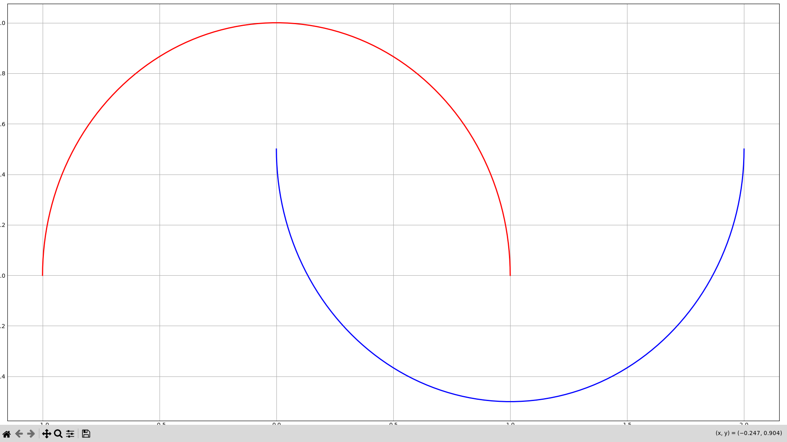
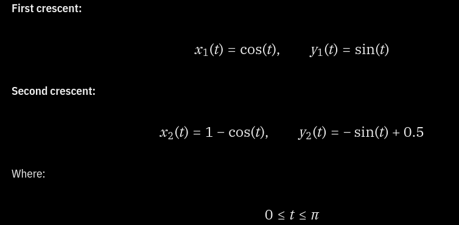
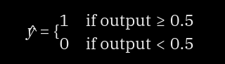

# NEURAL NETWORK FROM SCRATCH
This neural network was built in c++ from scratch to classify a custom generated two-moons dataset.

## ARCHITECTURE

Number of layers: 4
breakdown:
- Input Layer: 2 neurons
- Hidden Layer I: 10 neurons
- Hidden Layer II: 10 neurons
- Output Layer II: 1 neurons

## DATASET

Two-Moons refers to two crescent shaped classes on a graph. Which Looks something like this 

The dataset was generated using the following equations:

A few samples: 
0.748503,0.663131,0
0.878580,0.477595,0
1.231476,-0.472841,1
1.535606,-0.344468,1
0.101983,0.060040,1

- Training Dataset contains 149948 samples
- Testing Dataset contains 50000 samples

## IMPLEMENTATION
### Initialization of weights
- layer 1 and 2 use He Initialization
- layer 3 uses Xavier Initialization
### Initialization of biases
- initialized to 0
### Forward Pass
- Weighted Sum is calculated
- ReLU activation function is applied to layers 1, 2 and 3 
- Sigmoid activation function is applied to layer 4
### Cost Function
Binary Cross Entropy
$$
L(y, \hat{y}) = -\left[y\log(\hat{y}) + (1-y)\log(1-\hat{y})\right]
$$
### Back Propagation
- Backpropagation using the chain rule
- Weight and bias gradient calculations
- Stochastic gradient descent (SGD)

## TRAINING
- The network uses stochastic gradient descent (SGD), updating its weights and biases after each training sample.
- The training process:
- Load the training dataset.
- Perform forward propagation.
- Calculate binary cross-entropy loss.
- Calculate gradients through backpropagation.
- Update weights and biases.
- Repeat for multiple epochs.

## EVALUATION
The trained model is evaluated using a separate testing dataset.

Evaluation metrics:
- Average binary cross-entropy loss.
- Classification accuracy.

A prediction threshold of 0.5 is used to convert output probabilities into binary classes.

## TECHNOLOGIES
- C++
- Eigen 3.4
- Python
- matplotlib
- g++
